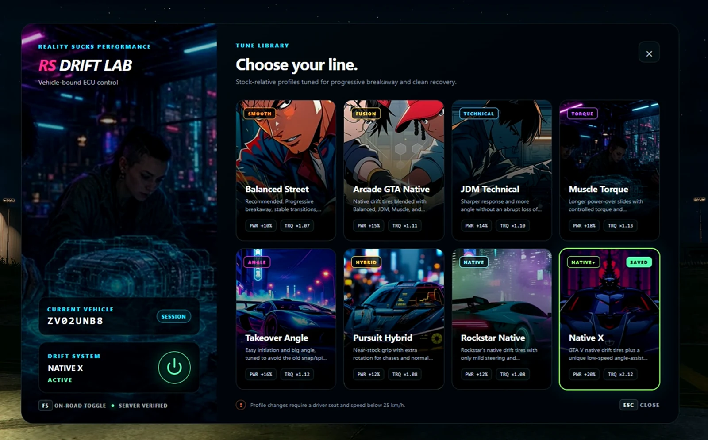

# RS Tuner Chip

A vehicle-bound FiveM drift controller with eight stock-relative handling profiles, validated installation, and built-in framework and inventory adapters.

[Download ZIP](https://github.com/RealitySucksRP/RealitySucks-TunerChip/releases/latest/download/rs-tunerchip.zip) · [GitHub](https://github.com/RealitySucksRP/RealitySucks-TunerChip) · [Website](https://realitysucksrp.github.io/) · [Store](https://reality-sucks-rp-webstore.tebex.io/) · [Discord](https://discord.gg/e9V3rPHySx) · [YouTube](https://www.youtube.com/@RealitySucksRP) · [Free scripts](https://reality-sucks-rp-webstore.tebex.io/category/free-scripts) · [Video preview](https://youtu.be/2VgFQiGvuLA?si=WnuSrLr1up_bH3ds)

[Package documentation](PACKAGE-README.md)
