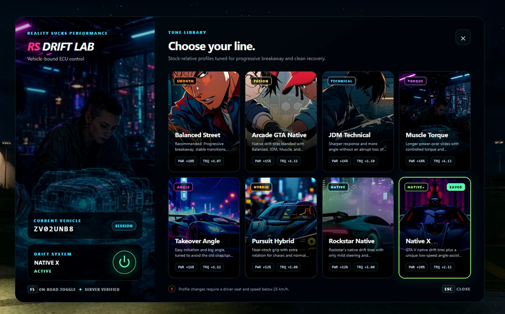
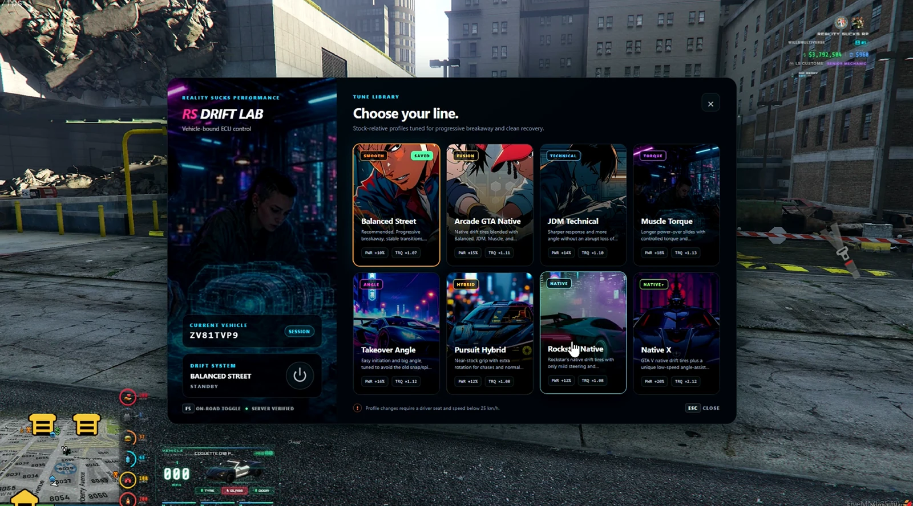

# RS Tuner Chip — Drift Controller

Install a tuner chip, pick a profile and send it sideways. Eight drift profiles apply controlled adjustments to each vehicle’s stock handling, with a dedicated controller and an option to restore the original setup. Vehicle-bound installation and mechanic exports connect the chip to your RP.

[Download the original ZIP](https://github.com/RealitySucksRP/RealitySucks-TunerChip/releases/latest/download/rs-tunerchip.zip) | [Free on Tebex](https://reality-sucks-rp-webstore.tebex.io/package/7391814) | [Watch preview](https://youtu.be/2VgFQiGvuLA?si=WnuSrLr1up_bH3ds) | [Website](https://realitysucksrp.github.io/) | [Discord](https://discord.gg/e9V3rPHySx) | [YouTube](https://www.youtube.com/@RealitySucksRP) | [All free scripts](https://reality-sucks-rp-webstore.tebex.io/category/free-scripts)

**Install folder:** `rs-tunerchip`. Download the original ZIP to retain the package folder layout. Source, configuration, licenses and included assets are provided below.

More screenshots

## Package documentation

# RS Tuner Chip

The supplied ZIP still calls the external `rs_bridge` exports for inventory-based installation. Follow the dependency/start-order instructions below for this package. 

Vehicle-bound drift controller for FiveM with server-authoritative install, removal, profile selection, and enable/disable state.

## Requirements

- `ox_lib`
- OneSync-enabled FiveM server
- A framework/inventory combination supported by your `rs_bridge` configuration for item-based installs

The resource is designed for Qbox, QBCore, and ESX through `rs_bridge`. Qbox and frameworks where `rs_bridge` can resolve a stable owned-vehicle ID receive persistent vehicle-bound installs. Other vehicles use session-only entity state unless `Config.PersistentPlateFallback` is deliberately enabled.

## Install

1. Place the folder in your resources directory as `rs-tunerchip`.
2. Ensure `ox_lib` and `rs_bridge` start before this resource.
3. Add the configured items to your inventory system:
   - `tunerchip`
   - `tunerchip_remover`
4. Add `ensure rs-tunerchip` after the dependencies in `server.cfg`.
5. Review `config.lua` before going live.

## Controls

- `F5` / `/drift` - toggle the installed drift profile
- `F10` / `/driftmenu` - open the drift controller
- `/driftstatus` - show the active profile and live slip information

Key mappings can be changed by the player through FiveM key bindings. Defaults can be changed in `config.lua`.

## Included Profiles

Balanced Street, Arcade GTA Native, JDM Technical, Muscle Torque, Takeover Angle, Pursuit Hybrid, Rockstar Native, and Native X.

Profiles are stock-relative: the script captures the current vehicle handling values and applies bounded multipliers instead of replacing the vehicle with one universal handling setup. Stock values are restored when drift mode is disabled or the resource stops.

## Customs Integration

Server resources listed in `Config.CustomsInstallers` can use:

- `exports['rs-tunerchip']:CanInstallFromCustoms(source, vehicleNetId)`
- `exports['rs-tunerchip']:InstallFromCustoms(source, vehicleNetId)`
- `exports['rs-tunerchip']:RollbackCustomsInstall(source, token)`

Only explicitly allowlisted server resources can use the customs installation flow.

## Notes

- Motorcycles and unsupported vehicle classes are blocked by default.
- Install/remove actions are revalidated server-side at completion.
- Profile changes require the player to be the live driver and below the configured speed limit.
- No webhook, remote code loader, external license token, or external account is required by this resource.

[Earlier repository documentation and all existing links](PREVIOUS_README.md)
